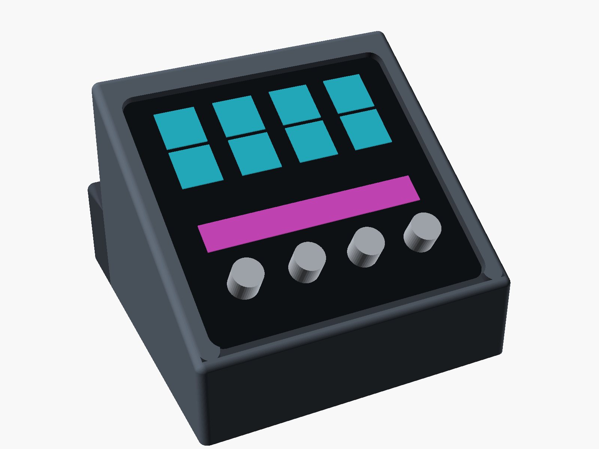
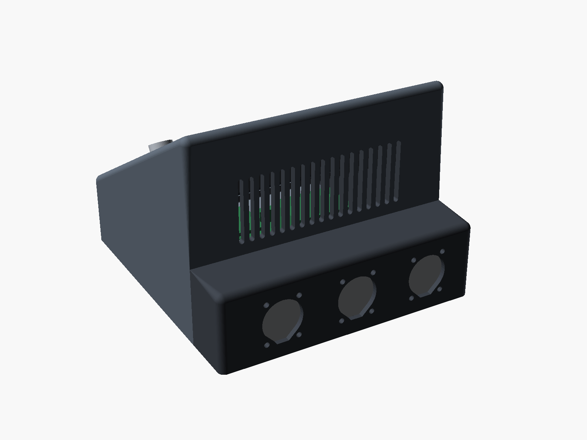
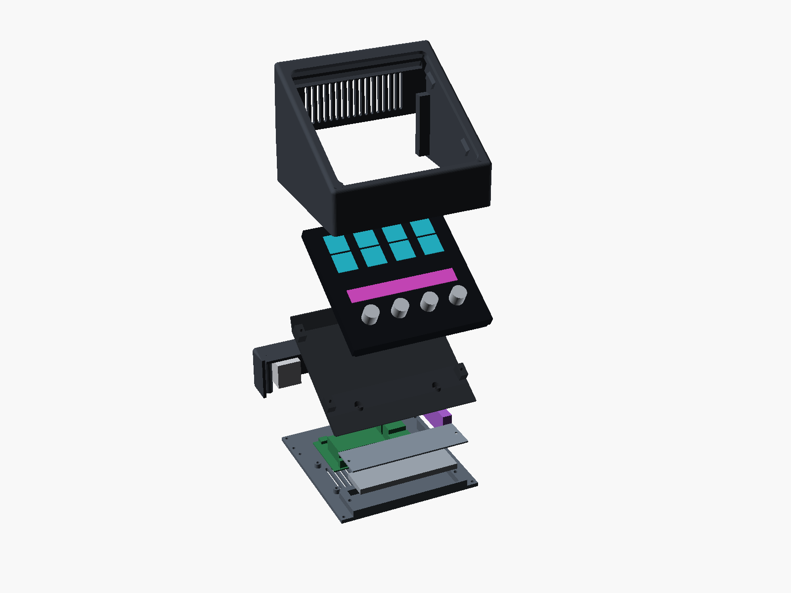
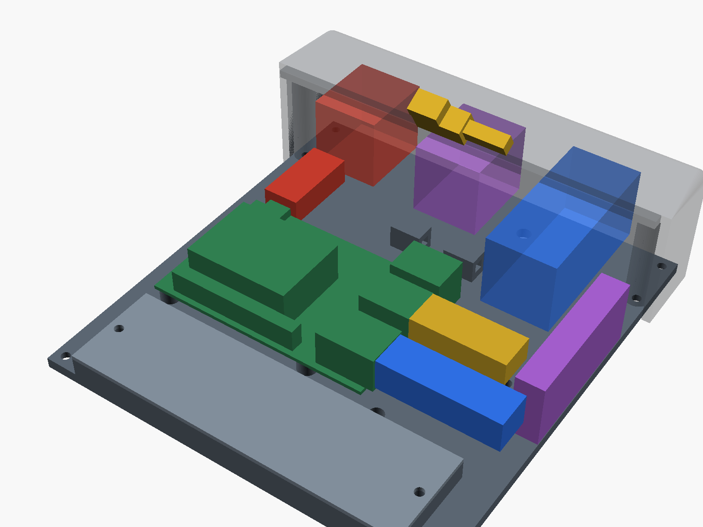

# Tischgehäuse Stream Deck + und Raspberry Pi 4

Keilförmiges Tischgehäuse für FoH und Ausstellung im Innenraum oder trocken und ohne pralle Sonne. Das Deck liegt 30° geneigt bündig im Korpus: Die Oberseite greift als Blende über seinen Rand, von innen hält es ein Bett an den schrägen Originalgewinden. Von außen sind keine Schrauben zu sehen, und das Deck lässt sich nicht nach oben herausheben. Der Pi liegt darunter. Hinten schließt ein flacher Kasten an, in dessen Rückwand drei Neutrik-Buchsen in D-Norm sitzen: USB-C für Strom, XLR für DMX und etherCON. Außenmaße mit Füßen 156 × 167 × 122 mm, der Kasten ist 51 mm hoch; Kanten 4 mm gerundet.

**Stand: nur am Modell geprüft, nichts gedruckt und nichts an echter Hardware anprobiert.** Die Maße des Decks stammen aus Elgatos CAD-Modell. Zuerst nur `bett.stl` drucken und das Deck einsetzen.






Weitere Ansichten liegen in `bilder/`.

## Dateien

| Datei | Inhalt |
|---|---|
| `gehaeuse.scad` | Modell, alle Parameter oben |
| `teile/*.stl` | ein STL je Druckteil, in Drucklage |
| `pruefe.py` | exportiert die STL und prüft das Modell, schreibt `pruefbericht.txt` (braucht `openscad`, `numpy`) |
| `deck_aus_stp.py` | erzeugt `lokal/deck.stl` aus Elgatos STP für die Prüfung; `lokal/` kommt nicht ins Repo |
| `ansichten.sh` | rendert `bilder/` |

Nach jeder Parameteränderung ausführen:

```bash
python3 hardware/gehaeuse/pruefe.py
```

```bash
bash hardware/gehaeuse/ansichten.sh
```

## Vor dem ersten Druck

**Zuerst `bett.stl` drucken.** Es enthält die Sitze, trägt also das, was am Deck passen muss. Gewindeeinsätze noch nicht nötig: Deck auflegen, Originalschrauben von unten von Hand eindrehen. Passt das, die übrigen Teile drucken; ob die Blende passt, zeigt dann der Korpus.

Noch offen, in `gehaeuse.scad`:

| Maß | Parameter | Wert jetzt | Stand |
|---|---|---|---|
| USB-Winkelstecker am Deck | `usb_gehaeuse`, `usb_hals_l` | Gehäuse 18 × 8 mm, Abgang quer | **Nach Händlerbild.** Hals muss höchstens 8,5 mm dick sein, sonst passt er nicht in die Mulde. Am gekauften Kabel messen und einmal ans Deck stecken |
| Stecker am Pi | `stecker_*` | USB-A 35 mm, RJ45 45 mm, USB-C 30 mm | **Annahme** |
| Buchsen samt Stecker innen | `tiefe_usb`, `tiefe_xlr`, `tiefe_eth` | 30 / 32 / 60 mm | USB-C und etherCON-Gehäuse aus Neutrik-Zeichnungen, XLR und RJ45-Stecker **Annahme** |
| Kühlkörper Pi | `kuehler_h` | 15 mm | **Annahme**, Kühler noch offen |
| Neutrik-Ausschnitt | `neutrik_*` | Ø24, Löcher Ø3,2 im Abstand 19 × 24 | [Neutrik-Zeichnungen](https://www.neutrik.com/en/product/ne8fdp) zu NE8FDP und NAUSBC-5G. Rückwand 3 mm: NC3FD-L-1 laut Händler 1–3 mm, NE8FDP bis 4 mm [Neutrik]; für NAUSBC nicht angegeben |
| Gewindeeinsätze | `einsatz_*_d` | Ø4,0 / Ø3,5 | **Annahme**, Bohrung des gekauften Einsatzes nehmen |
| Gewindetiefe | `sitz`, `loch_tiefe` | 5 mm Schraube im Gewinde | CAD: Sackloch 6,3 mm. **Originalschrauben nutzen, nichts Längeres** |

Maße des Decks aus [Elgatos STP-Modell](https://marketplace.elgato.com/product/render-asset-stream-deck-afa64cad-a62d-4962-be36-aa811310411c) (Version 1), vom User nachgemessen, soweit möglich:

| Maß | CAD | Gemessen |
|---|---|---|
| Breite × Höhe | 140,03 × 135,47 mm | 140 × 135 mm |
| Dicke, Rückplatte bis Rand | 29,37 mm | 29–30 mm |
| Lochabstand | 83 mm | 83 mm |
| Gewinde | Achse 49,7° zur Normalen der Rückplatte, Ø8-Dom, 21,24 mm vom Reglerrand | nicht messbar |
| USB-C | mittig auf der Rückplatte, 106,55 mm vom Reglerrand, Stecker senkrecht | |

Das CAD zeigt die Serie, nicht unbedingt dein Gerät; das Bett prüft es. Außerdem belegt: Gewicht 465 g und Schraube M3 × 0,5, 8 mm ([Elgato](https://help.elgato.com/hc/en-us/articles/10567379685901-Elgato-Stream-Deck-Technical-Specifications)), Lochbild und Buchsen des Pi 4 ([Raspberry Pi](https://datasheets.raspberrypi.com/rpi4/raspberry-pi-4-mechanical-drawing.pdf)), Bauraum 300 × 300 × 330 mm ([3DJake](https://www.3djake.com/prusa/core-one-l), Händlerangabe). Die Neutrik-Zeichnungen stehen auf den Produktseiten zu [NE8FDP](https://www.neutrik.com/en/product/ne8fdp) und [NAUSBC-5G](https://www.neutrik.com/en/product/nausbc-5g).

## Stückliste

Druckteile (PETG, zusammen etwa 450 g, laut `pruefbericht.txt` überschlägig):

| Teil | Zweck |
|---|---|
| `korpus` | Keil mit Blende, Schacht fürs Deck und Rückwand über dem Kasten |
| `boden` | Boden unter Keil und Kasten, trägt Pi, Ballast und RS485-Modul |
| `bett` | trägt das Deck von innen: schräge Sitze, Laschen. Einzeln nachdruckbar |
| `kasten` | flacher Kasten hinten mit den drei Buchsen-Ausschnitten |
| `ballastdeckel` | hält den Ballast |

Kaufteile:

| Menge | Teil |
|---|---|
| 14 | Gewindeeinsatz M3 × 5,7 |
| 4 | Gewindeeinsatz M2,5 |
| 2 | Originalschrauben des Deck-Fußes, dazu Kreuzschlitz-Dreher |
| 4 | M3 × 10, Bett in den Schacht, von unten |
| 8 | Sicherheits-Torx M3 × 10: Boden in Korpus und Kasten |
| 6 | M3 × 8 mit Mutter für die Neutrik-Buchsen, falls nicht beiliegend |
| 2 | M3 × 5, Ballastdeckel |
| 4 | M2,5 × 6 für den Pi |
| 1 | Neutrik NAUSBC-5G-FL10, USB-C mit 10 cm Kabel und USB-C-Stecker innen, für Strom |
| 1 | Neutrik NC3FD-L-1, XLR 3-polig female, DMX-Ausgang |
| 1 | Neutrik NE8FDP, etherCON |
| 1 | M5Stack Unit RS485-ISO (U094), dazu Litze verdrillt zur XLR-Buchse |
| 1 | Grove-Kabel auf Dupont-Buchsen, gewinkelt oder angelötet (über der Stiftleiste sind nur etwa 8 mm Platz) |
| 1 | RJ45-Patchkabel 0,25 m mit kurzem oder gewinkeltem Stecker, innen |
| 1 | USB-C-Winkelstecker auf USB-A, 30 cm, Deck zu Pi (vom User besorgt) |
| 1 | Pi-4-Netzteil mit USB-C, außen an der Neutrik-Buchse |
| 1 | Kühlkörper Pi 4, höchstens 15 mm |
| 1 | Flachstahl 105 × 30 × 6 mm, etwa 148 g |
| 4 | Gummifuß Ø12, 6 mm hoch (1 mm eingelassen) |
| 2 | M5-Schraube, Scheibe, Mutter für den Tisch (beim Publikum Pflicht) |
| 4 | Kabelbinder |

## Drucken

PETG, 0,4-mm-Düse, 0,2 mm Schicht, 5 Wände, 25 % Gyroid, keine Stützen. Klebestift oder Trennmittel auf glattem Bett, damit PETG nicht ausreißt. Heller Filament, falls Sonne nicht ganz auszuschließen ist.

| Teil | Lage (STL ist schon so gedreht) |
|---|---|
| `korpus` | Oberseite auf dem Druckbett, Öffnung oben. Die Blende wird so glatt wie das Druckbett. Die gerundeten Kanten liegen am Druckbett und hängen unten über: unterste Schichten prüfen, im Slicer Brim oder kleinere Rundung wählen, falls sie sich lösen |
| `bett` | Boden auf dem Druckbett. Die Schraubenkanäle liegen knapp über 45°; nacharbeiten, falls etwas hängt |
| `boden` | Boden auf dem Druckbett |
| `kasten` | Deckel auf dem Druckbett, Wände stehen. Die Buchsenausschnitte laufen nach oben spitz zu und drucken ohne Stütze; die Spitze liegt unter dem Flansch |
| Rest | flach |

Überhänge zeigt `pruefbericht.txt`. Die Flächen dort sind kurze Brücken und beim Korpus die Rundungen; ob sie sauber werden, zeigt erst der Druck.

## Montage

1. Einsätze mit dem Lötkolben setzen. Pi-Säulen und Fußtaschen ansehen, ob Grate stören.
2. Füße kleben. Ballast in die Wanne, Deckel drauf.
3. Pi mit Kühlkörper auf den Boden schrauben. RS485-Modul hochkant in den Halter an der rechten Wand stellen und mit einem Kabelbinder sichern.
4. Neutrik-Buchsen von außen in die Rückwand des Kastens schrauben, Flansch außen. Zur XLR-Buchse drei Litzen vom Modul löten: Pin 1 Schirm, Pin 2 D−, Pin 3 D+. Am Modul laut Schaltplan: 4 = B (D−), 3 = A (D+), 1 = Schirm; am Aufkleber prüfen.
5. Kasten von hinten über den Boden setzen, mit vier Schrauben von unten befestigen. Patchkabel von der etherCON-Buchse zum Pi, USB-C-Kabel der Neutrik-Buchse als Schlaufe in der hinteren linken Ecke zum Pi führen (für einen geraden Weg ist zwischen Buchse und Pi kein Platz).
6. Grove-Kabel vom Modul zum Pi: rot an Pin 2 (5 V), schwarz an Pin 6 (GND), der Eingang des Moduls (laut Schaltplan IO1 „UART_Rx“, beim Grove-Kabel vermutlich gelb) an Pin 8 (GPIO 14, TX). Die Farbzuordnung am Aufkleber des Moduls prüfen.
7. Beim Publikum: Boden mit den zwei M5-Schrauben auf den Tisch schrauben.
8. Fuß vom Deck abschrauben. Deck auf das Bett legen, die zwei Originalschrauben von unten durch die schrägen Kanäle eindrehen. Nur handfest, das Gewinde sitzt im Deck.
9. USB-Kabel ins Deck stecken. Deck mit Bett von unten in den Schacht des Korpus schieben, bis der Rand an der Blende liegt, und das Bett mit vier M3 × 10 von unten anschrauben. Kabel in den Pi stecken, mit Kabelbindern an den Ösen führen, Schlaufe lassen.
10. Korpus senkrecht über den Boden stülpen. Seine Rückwand setzt auf die Zunge des Kastendeckels auf. Von unten vier Schrauben.

Für die SD-Karte muss der Korpus ab (Boden bleibt verschraubt), das ist gewollt.

## Entscheidungen

- **Neigung 30°:** flach genug für den Griff von oben im Stehen, am FoH sitzend noch lesbar. Parameter `neigung`; ändern verschiebt die Höhe. Nur am Modell beurteilt.
- **Bündiges Deck, schmal und flach:** Wunsch des Users. Seitlich sind es außen 10,5 mm bis zur Sichtöffnung, die Bett-Schrauben sitzen dort, wo sich die Rückseite des Decks zur Seite wegschrägt. Vorderkante 42 mm, damit die Ethernet-Buchse des Pi unter das Bett passt. Hinten ein flacher Kasten statt eines längeren Keils: mehr Standfläche nach hinten, Gesamthöhe bleibt.
- **Keine Abdichtung:** laut User nur außerhalb der Regie. PETG reicht dort; es wird ab etwa 70 °C weich, deshalb nicht in die Sonne stellen. Das Deck selbst ist nicht wetterfest.
- **Buchsen statt Kabeldurchführung und Haube:** Wunsch des Users. Neutrik-Stecker verriegeln selbst, Kabel werden außen am Tisch gesichert. Die Flanschschrauben der Buchsen sind von außen erreichbar, das Innere nur nach Lösen der Schrauben von unten.
- **DMX über RS485 am UART:** M5Stack Unit RS485-ISO, isoliert, 56 × 24 × 10,2 mm ([M5Stack](https://docs.m5stack.com/en/unit/Unit_RS485-ISO)). Laut Schaltplan liegt der Sendereingang DI fest auf Masse, die Richtung schaltet das Signal vom Pi: Bit 0 treibt die Leitung aktiv, Bit 1 und Ruhe halten nur Widerstände. Mit 120-Ω-Abschluss ist das ein kleiner Pegel; ob die Empfänger der Spiegel-Elemente das sicher als 1 lesen, nur im Test mit einem Element und voller Kabellänge prüfbar. Am Pi: PL011 auf GPIO 14 mit `dtoverlay=disable-bt`, serielle Konsole aus, 250 000 Baud 8N2; der Treiber in `server/src/ausgabe/rs485.ts` fehlt noch.
- **Lüftung:** Zuluft durch Schlitze im Boden (Füße heben 5 mm an), Abluft durch 17 Schlitze in der Rückwand über dem Kasten. Ein Lüfter ist nicht mehr vorgesehen, an der Seitenwand steht jetzt das RS485-Modul. **Kühlung nicht gemessen.** Im Dauerbetrieb prüfen:

```bash
vcgencmd measure_temp
```

```bash
vcgencmd get_throttled
```

  Bleibt der Pi unter 70 °C und `get_throttled` meldet `0x0`, reicht es. Sonst einen flacheren Kühlkörper mit Lüfter auf dem Pi.

## Geprüft am Modell

Siehe `pruefbericht.txt`: alle STL dicht, passen in den Bauraum, keine Überschneidung zwischen Teilen und Platzhaltern für Deck, Pi, USB-, RJ45- und Netzstecker, die drei Neutrik-Buchsen und das RS485-Modul. Die Kabelschlaufen innen sind nicht modelliert.

Das echte Elgato-Modell wird punktweise gegen die Teile geprüft, weil sein Netz nicht geschlossen ist. Auch der Gegentest war positiv: Schon 0,25 mm Versatz des Betts meldet Berührung; Sitze und Bohrungen fluchten im Schnitt mit den Domen. Die Prüfung läuft nur, wenn `lokal/deck.stl` vorhanden ist:

```bash
DECK_STP=~/Downloads/stream-deck-stp-1.stp /Applications/FreeCAD.app/Contents/Resources/bin/freecadcmd hardware/gehaeuse/deck_aus_stp.py
```

**Standfestigkeit:** Waagerecht an der Deck-Oberkante kippt das Gehäuse überschlägig nach vorn bei etwa 5,7 N, zur Seite bei 5,8 N, nach hinten dank Kasten erst bei 8,4 N (mit Ballast). Frei stehend ist das nur am FoH vertretbar. **Beim Publikum das Gehäuse auf den Tisch schrauben.** Mehr Ballast verschiebt das kaum genug.

Nicht geprüft: Festigkeit, vor allem der schrägen Sitze unter Zug, Passung der Einsätze, Temperatur, Kabelführung im Raum (Biegeradien), echte Bedienung. Platzhalter für Stecker und Pi sind einfache Quader.

## Anregungen und Lizenzen

Neu konstruiert, keine fremde Geometrie übernommen; aus Elgatos STP stammen nur Maße, die Datei selbst liegt nicht im Repo. Als Idee dienten der [Ständer für XL und Pi 5](https://makerworld.com/de/models/2168960-stream-deck-xl-raspberry-pi-5-hybrid-stand) (CC BY-SA), das [CompanionPi4-Gehäuse](https://makerworld.com/de/models/1533869-companionpi4-streamdeck-case) und der [Adapter für den Stream Deck +](https://makerworld.com/de/models/946518-1-4-20-mount-adapter-for-stream-deck-plus) (CC BY-NC-SA, bestätigt die Nutzung der Fußschrauben).
